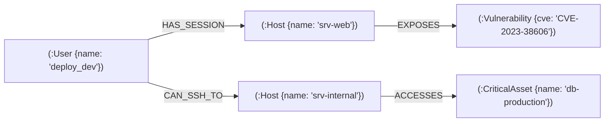

# InfraGraph Analyzer

Graph-based infrastructure attack path analysis and lateral movement engine built with Neo4j and FastAPI.

## Problem Statement

In modern infrastructure, security vulnerabilities rarely occur in a vacuum. A low-severity vulnerability on a public web server, an active deployment credential left in memory, and an overly permissive internal SSH rule can be chained together into a complete breach path:



Relational queries struggle to compute multi-hop reachability across large networks. InfraGraph Analyzer models hosts, credentials, vulnerabilities, and assets as a directed graph in Neo4j to compute deterministic shortest attack paths, identify high-centrality chokepoints, and evaluate defense-in-depth segmentation.

## Project Status

This repository is currently under active development (v0.1.0). The domain architecture and data contracts are defined; the core engine, scenario loader, and Docker Compose stack are being implemented incrementally.

Detailed specifications:
* [Market Benchmark and Scope (Phase 1)](docs/phase_1_benchmark_uvp.md)
* [Product Requirements and Data Model Specification (Phase 2)](docs/phase_2_prd_data_model.md)

## Planned API Contract

### Attack Path Audit (`POST /api/v1/attack-path`)

Analyzes whether a lateral movement path exists between an initial entry host and a targeted crown jewel.

**Request:**
```json
{
  "start_host_id": "srv-web",
  "target_asset_id": "db-production"
}
```

**Response:**
```json
{
  "found": true,
  "hops_count": 4,
  "attack_vector": [
    { "step": 1, "node": "srv-web", "type": "Host", "detail": "Internet-facing entry host" },
    { "step": 2, "node": "CVE-2023-38606", "type": "Vulnerability", "detail": "Exploited to access local session" },
    { "step": 3, "node": "deploy_dev", "type": "User", "detail": "Compromised credential reused for pivot" },
    { "step": 4, "node": "srv-internal", "type": "Host", "detail": "Internal host reachable via SSH" },
    { "step": 5, "node": "db-production", "type": "CriticalAsset", "detail": "Target asset reached" }
  ],
  "chokepoints": ["deploy_dev", "srv-internal"]
}
```

## Architecture and Technology Choices

* **Runtime:** Python 3.11+
* **REST API:** FastAPI with modular routers and strict Pydantic v2 validation.
* **Graph Database:** Neo4j Community Edition via the official Python driver, using Cypher graph traversal algorithms.
* **Code Quality:** Ruff for linting and formatting, pytest for unit and integration testing.
* **Containerization:** Docker Compose for reproducible local deployment with seeded scenario datasets.

## Development Roadmap

### Phase 1: Specifications (Completed)
- [x] Architecture design and comparative benchmark (`docs/phase_1_benchmark_uvp.md`).
- [x] Domain model and API contract specifications (`docs/phase_2_prd_data_model.md`).

### Phase 2: Core Engine & REST API (In Progress)
- [ ] Pydantic v2 schemas for domain entities (`Host`, `Vulnerability`, `User`, `CriticalAsset`).
- [ ] Declarative JSON scenario loader (`scenarios/` test fixtures).
- [ ] Neo4j graph repository and Cypher shortest-path algorithms.
- [ ] FastAPI endpoints: `/api/v1/attack-path`, `/api/v1/critical-nodes`, and `/api/v1/scenarios/seed`.
- [ ] Docker Compose setup with automated seed data loading.
- [ ] Integration test suite with pytest.

### Phase 3: AI Explainer & Visualizer (v2.0)
- [ ] GraphRAG remediation engine (translating validated graph paths into actionable patch instructions).
- [ ] Interactive graph topology visualizer.

## License

MIT License. See `LICENSE` for details.
