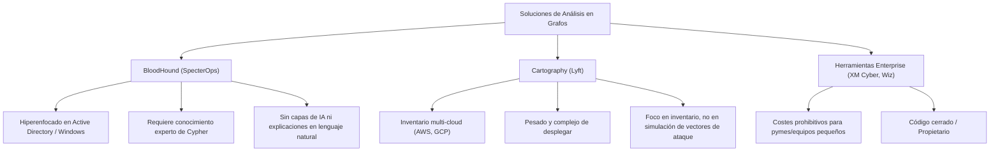

# Fase 1: Benchmark de Mercado y Propuesta de Valor Única (UVP)

> **Proyecto:** InfraGraph Analyzer  
> **Objetivo de la fase:** Identificar qué existe en el ecosistema, detectar los vacíos de mercado y definir qué hace único a nuestro proyecto antes de escribir código.

---

## 1. Análisis del Ecosistema Actual (Benchmark)

Para entender dónde se sitúa **InfraGraph Analyzer**, analizamos las soluciones de referencia en análisis de infraestructura y rutas de ataque basadas en grafos:

### Tabla Comparativa de Soluciones

| Característica | BloodHound | Cartography (Lyft) | Soluciones Enterprise (Wiz, XM Cyber) | **InfraGraph Analyzer (Nuestra propuesta)** |
| :--- | :--- | :--- | :--- | :--- |
| **Enfoque principal** | Rutas de ataque en Active Directory / Azure | Mapeo e inventario de activos cloud | Postura de seguridad (CSPM / CIEM) integral | **Rutas de ataque agnósticas (Cloud + Linux/K8s + Red local)** |
| **Facilidad de despliegue** | Media / Alta (necesita SharpHound, recopiladores AD) | Baja (infraestructura de sincronización pesada) | SaaS administrado (sin despliegue local) | **Inmediata (`docker compose up` en 1 minuto)** |
| **Curva de aprendizaje** | Alta (necesita aprender sintaxis Cypher avanzada) | Alta (Python + consultas Neo4j personalizadas) | Baja (paneles web interactivos) | **Baja (UI interactiva + consultas asistidas por IA)** |
| **Capa de IA / GraphRAG** | ❌ No disponible | ❌ No disponible | Parcial / Asistentes genéricos | **✅ Nativa: Explicación de rutas y mitigación con LLM** |
| **Licencia** | Open Source (versión Community) / Enterprise | Open Source (Apache 2.0) | Propietaria / Pago por recurso | **Open Source (MIT / Apache 2.0)** |

---

## 2. Los Vacíos de Mercado Detectados

1. **Falta de soluciones agnósticas y ligeras:**  
   La mayoría de herramientas se van a dos extremos: o son scripts monolíticos que solo escanean un Active Directory empresarial, o son suites complejas de análisis cloud orientadas a grandes corporaciones. No existe un estándar ligero para desarrolladores, auditores y equipos DevOps que quieran modelar su topología rápidamente.

2. **La "barrera de Cypher":**  
   Aunque Neo4j es la base ideal para grafos, la gran mayoría de analistas y administradores de sistemas no saben escribir consultas Cypher como `MATCH p = shortestPath(...)`.

3. **Falta de contextualización y remediación asistida:**  
   Encontrar que existe un camino de 4 saltos entre un servidor web y una base de datos es útil, pero el verdadero valor añadido es explicar:
   * *¿Por qué ese salto es posible?*
   * *¿Cuál es el corte mínimo (la arista más barata de romper) para neutralizar la amenaza?*
   * *¿Qué comandos exactos (iptables, parche CVE, revocación de IAM) eliminan el riesgo?*

---

## 3. Propuesta de Valor Única (UVP)

> **"InfraGraph Analyzer transforma la topología de red y los hallazgos de seguridad en un grafo interactivo explicable por IA, permitiendo simular ataques y generar planes de mitigación automáticos sin necesidad de dominar Cypher."**

> [!IMPORTANT] Nota de Fases y Blindaje del Alcance (MVP v1 vs. Visión v2)
> La UVP completa define la **visión terminada del producto**. Para evitar el efecto bola de nieve y garantizar código bajo control estricto:
> * **v1 (MVP Core):** Motor algorítmico determinista (`shortestPath`, `blast-radius`), esquema estricto en Neo4j, ingesta de escenarios JSON declarativos, y API REST documentada en FastAPI con Docker Compose y datos de prueba precargados (*Zero Friction*).
> * **v2 (Capa Inteligente & UI):** Módulo de GraphRAG (*AI Security Explainer / Remediation* que toma la ruta matemática comprobada y redacta el informe/mitigación técnica) e interfaz web visual interactiva. Se descarta *Text-to-Cypher* para evitar alucinaciones sintácticas.

### Pilares Clave de InfraGraph Analyzer:
1. **Modelado Agnóstico y Sencillo:** Formato de entrada declarativo (JSON/YAML) o simulación sintética de red sin requerir agentes invasivos instalados en las máquinas.
2. **Algoritmos de Grafo Nativos:** Detección de caminos más cortos (*shortestPath*), análisis de cuello de botella (*betweenness centrality*) y radio de impacto (*blast radius*).
3. **GraphRAG para Explicabilidad:** El motor de IA no "adivina" la seguridad: toma la ruta exacta probada matemáticamente por el grafo y la traduce en un informe ejecutivo con recomendaciones técnicas precisas.
4. **Enfoque Portfolio / Open Source:** Código limpio, tipado estricto con Python y FastAPI, pruebas unitarias y despliegue contenedorizado reproducible.

---

## 4. Decisiones Clave para Validar

Para cerrar la Fase 1 y pasar a la **Fase 2 (PRD y Requisitos del MVP)**, confirma o matiza los siguientes puntos:

1. **Escenario de datos inicial para el MVP:**  
   * ¿Prefieres empezar con un **generador de escenarios sintéticos realistas** (ej. "Empresa Fintech con Web pública, Kubernetes interno y Base de Datos") para que el proyecto sea 100% autónomo y usable de inmediato?
2. **Nivel de interacción de la IA:**  
   * ¿Queremos que el LLM simplemente explique la ruta encontrada, o también que permita consultar en lenguaje natural (ej. *"¿Qué máquinas pueden alcanzar la base de datos?"*) convirtiéndolo a Cypher?
