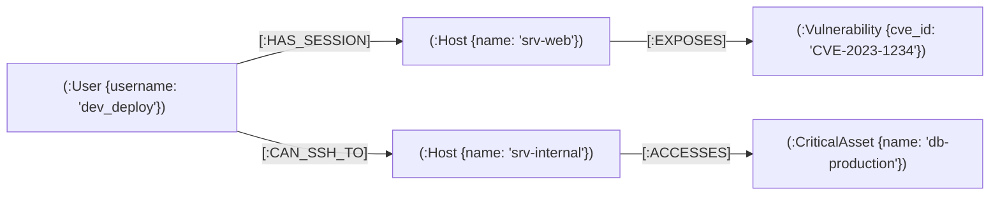

# Fase 2: Documento de Requisitos del Producto (PRD) y Modelo de Datos

> **Proyecto:** InfraGraph Analyzer  
> **Versión:** 1.0.0 (MVP Core)  
> **Estado:** Propuesta para Validación  

---

## 1. Alcance y Fronteras del MVP (v1 vs. v2)

Para blindar el desarrollo y mantener un avance atómico y predecible, establecemos los límites estrictos del sistema:

```mermaid
graph LR
    subgraph "MVP v1 (Alcance Actual)"
        A["Ingesta Declarativa (JSON)"] --> B["Esquema Estricto Neo4j"]
        B --> C["Motor de Rutas (ShortestPath & Blast Radius)"]
        C --> D["FastAPI REST Endpoints + Swagger UI"]
        D --> E["Docker Compose + Seed Data Automatizado"]
    end

    subgraph "v2 (Alcance Posterior)"
        F["GraphRAG: AI Security Explainer & Remediation"]
        G["Visualizador Web Interactivo (UI)"]
        H["Conectores en Vivo (Nmap / AWS Ingestion)"]
    end

    MVP v1 --> v2
```

### Tabla de Inclusiones / Exclusiones

| Característica | v1 (MVP) | v2 |
| :--- | :---: | :---: |
| Modelado de grafo en Neo4j (4 nodos, 4 relaciones) | ✅ | Extensible |
| Ingesta de topología vía JSON declarativo | ✅ | ✅ |
| Carga automática de escenarios de prueba (*Seed Data*) | ✅ | ✅ |
| Endpoint `/attack-path` (algoritmo determinista de saltos) | ✅ | ✅ |
| Endpoint `/critical-nodes` (análisis de cuellos de botella / radio de impacto) | ✅ | ✅ |
| Documentación interactiva OpenAPI (Swagger) | ✅ | ✅ |
| Despliegue con un comando (`docker compose up`) | ✅ | ✅ |
| Cobertura de pruebas unitarias e integración con Pytest | ✅ | ✅ |
| Explicador de rutas y mitigación asistida por LLM (GraphRAG) | ❌ | ✅ |
| Interfaz gráfica web de usuario (React/Cytoscape) | ❌ | ✅ |
| Conectores directos en vivo (Nmap, Nessus, AWS API) | ❌ | ✅ |

---

## 2. Especificación del Modelo de Grafos (Neo4j)

El grafo modela los vectores de ataque minimizando la complejidad a **4 tipos de nodos** y **4 tipos de relaciones**:



### 2.1. Nodos (Entities)

1. **`:Host`** (Máquinas, instancias virtuales o contenedores)
   * `id`: string (Identificador único, ej. `"host-web-01"`)
   * `name`: string (Nombre legible, ej. `"srv-web-public"`)
   * `ip`: string (Dirección IP, ej. `"192.168.1.10"`)
   * `is_exposed`: boolean (`true` si tiene acceso directo desde Internet)

2. **`:Vulnerability`** (Fallas de seguridad conocidas o CVEs)
   * `cve_id`: string (Identificador CVE, ej. `"CVE-2023-38606"`)
   * `severity`: string (`"LOW"`, `"MEDIUM"`, `"HIGH"`, `"CRITICAL"`)
   * `cvss_score`: float (ej. `9.8`)
   * `description`: string (Resumen del fallo)

3. **`:User`** (Cuentas, credenciales o roles de servicio)
   * `username`: string (Identificador, ej. `"svc_backup"`)
   * `role`: string (ej. `"ServiceAccount"`, `"Developer"`, `"Admin"`)
   * `is_privileged`: boolean (`true` si cuenta con permisos de administración)

4. **`:CriticalAsset`** (La "joya de la corona" a proteger)
   * `id`: string (ej. `"asset-db-prod"`)
   * `name`: string (ej. `"Production-Customer-Database"`)
   * `asset_type`: string (`"DATABASE"`, `"DOMAIN_CONTROLLER"`, `"SECRET_VAULT"`)
   * `business_impact`: string (`"HIGH"`, `"CATASTROPHIC"`)

### 2.2. Relaciones (Edges)

1. **`(:Host)-[:EXPOSES]->(:Vulnerability)`**  
   Indica que el host corre un servicio vulnerable que un atacante puede explotar como punto de entrada.
2. **`(:User)-[:HAS_SESSION]->(:Host)`**  
   Credencial o sesión activa presente en ese host (si el host se compromete, la credencial queda expuesta).
3. **`(:User)-[:CAN_SSH_TO]->(:Host)`**  
   Permiso lateral: el usuario posee acceso remoto por SSH/RDP hacia otro host interno.
4. **`(:Host)-[:ACCESSES]->(:CriticalAsset)`**  
   Conexión directa autorizada de red o aplicación hacia el activo crítico final.

---

## 3. Esquema Declarativo del JSON de Entrada

Todo escenario de prueba (incluyendo `fintech_compromise.json`) sigue una estructura estándar validada con **Pydantic**:

```json
{
  "scenario_name": "Fintech Customer DB Compromise",
  "version": "1.0",
  "hosts": [
    {
      "id": "srv-web",
      "name": "Public Web App",
      "ip": "203.0.113.15",
      "is_exposed": true
    },
    {
      "id": "srv-internal",
      "name": "Backend Payment Processor",
      "ip": "10.0.2.40",
      "is_exposed": false
    }
  ],
  "vulnerabilities": [
    {
      "cve_id": "CVE-2023-38606",
      "severity": "CRITICAL",
      "cvss_score": 9.8,
      "description": "Remote Code Execution in Web Service"
    }
  ],
  "users": [
    {
      "username": "deploy_user",
      "role": "DevOps",
      "is_privileged": true
    }
  ],
  "critical_assets": [
    {
      "id": "db-production",
      "name": "Fintech Cards Database",
      "asset_type": "DATABASE",
      "business_impact": "CATASTROPHIC"
    }
  ],
  "relationships": [
    { "source": "srv-web", "type": "EXPOSES", "target": "CVE-2023-38606" },
    { "source": "deploy_user", "type": "HAS_SESSION", "target": "srv-web" },
    { "source": "deploy_user", "type": "CAN_SSH_TO", "target": "srv-internal" },
    { "source": "srv-internal", "type": "ACCESSES", "target": "db-production" }
  ]
}
```

---

## 4. Contrato de la API REST (FastAPI)

### 4.1. `POST /api/v1/attack-path`
Calcula la ruta de ataque más corta entre un punto de entrada y un activo crítico.

* **Request Body:**
```json
{
  "start_host_id": "srv-web",
  "target_asset_id": "db-production"
}
```

* **Response Body (200 OK):**
```json
{
  "found": true,
  "hops_count": 4,
  "attack_vector": [
    { "step": 1, "node_type": "Host", "id": "srv-web", "action": "Entry point (Internet exposed)" },
    { "step": 2, "node_type": "Vulnerability", "id": "CVE-2023-38606", "action": "Exploitation allows session theft" },
    { "step": 3, "node_type": "User", "id": "deploy_user", "action": "Compromised credential used for pivot" },
    { "step": 4, "node_type": "Host", "id": "srv-internal", "action": "Lateral SSH movement" },
    { "step": 5, "node_type": "CriticalAsset", "id": "db-production", "action": "Data breach achieved" }
  ],
  "chokepoints": ["deploy_user", "srv-internal"]
}
```

### 4.2. `GET /api/v1/critical-nodes`
Devuelve los nodos con mayor centralidad/cuello de botella de la infraestructura (los activos que, de comprometerse, abren mayor radio de ataque).

* **Response Body (200 OK):**
```json
{
  "total_analyzed": 12,
  "top_chokepoints": [
    {
      "node_id": "deploy_user",
      "type": "User",
      "impact_percentage": 85.0,
      "risk_reason": "High credential exposure across internal hosts"
    }
  ]
}
```

### 4.3. `POST /api/v1/scenarios/seed`
Recibe o carga un escenario JSON y regenera el grafo en Neo4j de forma idempotente.

### 4.4. `GET /api/v1/health`
Verifica la conexión viva con Neo4j y la integridad de la API.

---

## 5. Criterios de Aceptación del MVP

1. **Ejecución Zero-Friction:** Al clonar y ejecutar `docker compose up -d`, tanto la API como Neo4j quedan en estado *Healthy* y el escenario `fintech_compromise.json` queda precargado.
2. **Determinismo:** La consulta a `/api/v1/attack-path` devuelve el camino exacto sin tiempos de espera (> 200 ms).
3. **Escenario Seguro (Prueba Negativa):** Al consultar un escenario aislado (`scenario_secure_segmented.json`), la respuesta devuelve `{"found": false, "attack_vector": []}`.
4. **Cobertura de Tests:** Pruebas unitarias de los esquemas Pydantic y pruebas de integración con Neo4j pasando con éxito en `pytest`.
